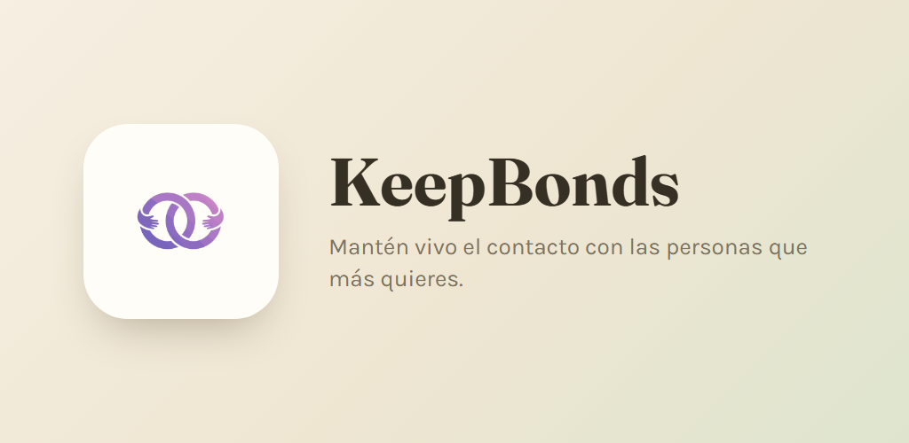
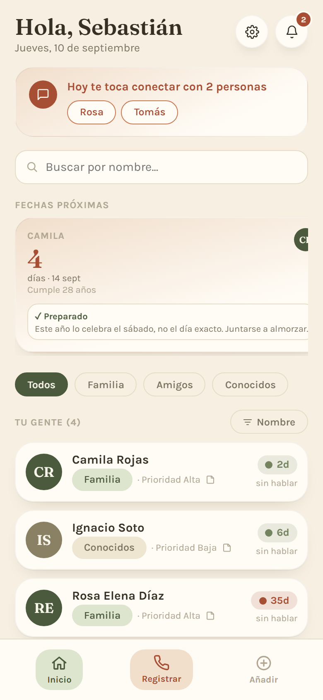
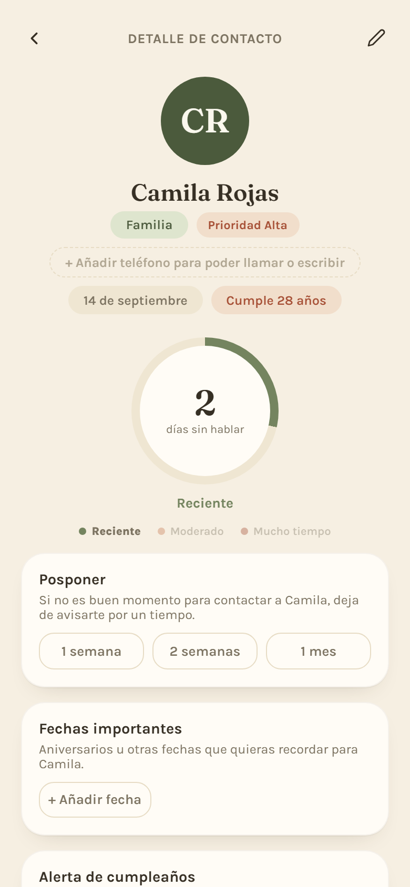
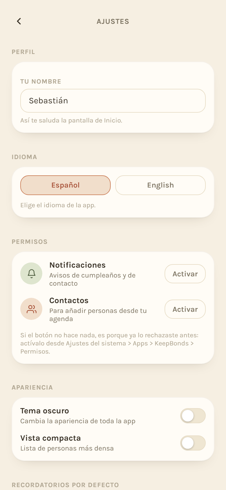
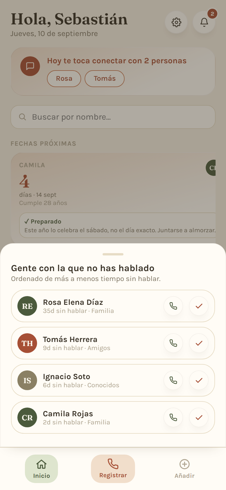
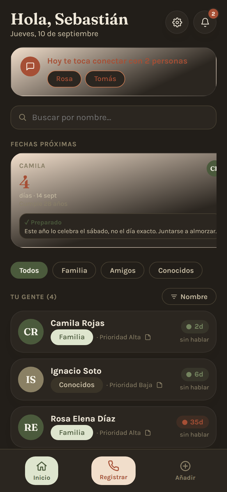

# KeepBonds



**Mantén vivo el contacto con las personas que más quieres.**

KeepBonds es una app para Android que avisa cumpleaños con anticipación, te recuerda cuando llevas tiempo sin hablar con alguien importante, y te deja anotar todo lo que quieras recordar de cada persona antes de llamarla. Funciona 100% sin conexión: no tiene servidor propio, no hay cuentas, y tus datos nunca salen de tu teléfono.

📄 [Política de privacidad](https://sebaitax.github.io/keepbonds/privacy-policy.html) · Disponible en español e inglés.

## Capturas de pantalla

<p align="center">
  
  
  
  
  
</p>

## Qué puedes hacer

- Agregar a las personas importantes de tu vida, con rol, prioridad y frecuencia de contacto deseada.
- Recibir avisos de cumpleaños con los días de anticipación que tú elijas.
- Ver de un vistazo cuánto tiempo llevas sin hablar con cada persona.
- Guardar notas y fechas importantes (aniversarios, etc.) para cada contacto.
- Registrar llamadas y conversaciones con un toque, desde la pestaña de Registrar.
- Posponer recordatorios cuando no es buen momento para contactar a alguien.
- Respaldar y restaurar tus datos manualmente (exportar/importar como JSON), cuando tú quieras.
- Usar la app en **español o inglés**, con detección automática del idioma del sistema y modo oscuro incluido.

## Privacidad primero

- Sin servidor propio, sin cuentas, sin inicio de sesión.
- Sin publicidad ni rastreadores de ningún tipo.
- Todos los datos viven únicamente en el almacenamiento local del dispositivo.
- El permiso de contactos es opcional y de un solo uso: solo se lee la persona puntual que eliges importar.

Más detalle en la [política de privacidad](https://sebaitax.github.io/keepbonds/privacy-policy.html).

## Stack técnico

- [Capacitor](https://capacitorjs.com/) 6 como shell nativo de Android
- [React](https://react.dev/) 18, en un único archivo fuente (`src/app.jsx`)
- [esbuild](https://esbuild.github.io/) para el bundle de producción
- [Playwright](https://playwright.dev/) para las pruebas end-to-end (`scripts/test.mjs`, `scripts/stress-test.mjs`)
- [sharp](https://sharp.pixelplumbing.com/) para generar los assets del ícono y el splash screen

## Desarrollo local

```bash
npm install
node scripts/build.mjs        # genera www/bundle.js
npx cap sync android          # sincroniza el proyecto Android
```

Para levantar las pruebas automatizadas contra el bundle generado:

```bash
node scripts/test.mjs          # flujo completo de la app
node scripts/stress-test.mjs   # 60+ contactos sintéticos, casos límite
```

Para regenerar el ícono y el splash desde `assets/icon-source.svg`:

```bash
node scripts/make-icon.mjs
```

## Contacto

¿Preguntas sobre la app? Escribe a **sebaitax@hotmail.com**.
